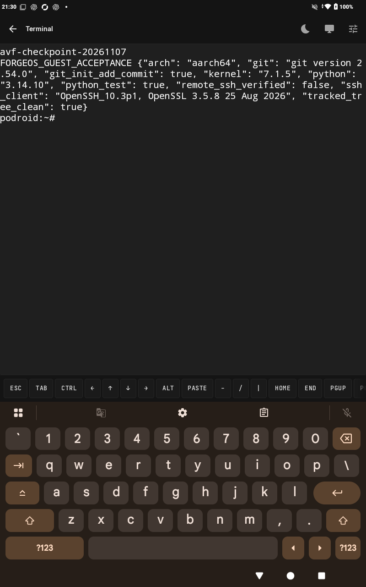

# Verified interim Linux environment

The onn tablet now boots a real Alpine Linux guest through Android Virtualization Framework (AVF) and MediaTek GenieZone while stock Android remains running. This is an interim two-environment workstation, **not genuine dual boot or installed ForgeOS Android firmware**. The independent GPL-2.0 [Podroid companion](https://github.com/ExTV/Podroid/tree/ce0121896b2895637ab1f656cbb0d75fa2874489) retains its original attribution.

## Actual target results

| Check | Result |
|---|---|
| Publisher APK | v1.2.9; exact size/hash, Android signer, package and ARM64 content verified before installation |
| Hardware guest | AVF/GenieZone, non-protected VM; Alpine 3.24.2, kernel 7.1.5, aarch64 |
| Bounded allocation | 512 MiB RAM, 1 CPU, 2 GiB sparse persistent disk; automatic CPU scaling off |
| AVF startup | Ready observed after 10 seconds, both initial boot and later restart |
| Console | Actual login and shell commands verified |
| Python | 3.14.10; a real source module and unittest passed inside the guest |
| Git | 2.54.0; init, add, commit and clean tracked-tree checks passed |
| SSH | OpenSSH 10.3p1 binary runs; no remote session verified; SSH remains disabled |
| Persistence | Checkpoint and installed tools survived AVF to QEMU to AVF transition |
| Host headroom | MemAvailable 1,120,412 KiB and internal free 3,253,340 KiB sampled after AVF restart; not peak measurements |
| Shutdown | Supported companion stop reached stopped; stock fingerprint, HOME, locked bootloader, green AVB and both SD volumes rechecked |

[Physical acceptance](evidence/avf-20261107/acceptance.json), [stock integrity](evidence/avf-20261107/stock-integrity.json), [state traces and hashes](evidence/avf-20261107/sha256.json).

## Network diagnosis and efficient fallback

The actual AVF guest exposes loopback and dummy0 only, with no usable NIC, route or resolver file. Its package installation failed; changing DNS cannot create the missing NIC. AVF guest Internet is **not working on this stock build**.

A deliberately selected QEMU software-emulation trial used the same verified companion and persistent disk, after AVF was stopped. It reached Ready after 110 seconds and obtained a real eth0 route. Alpine signed package installation fetched Python, Git and the SSH client successfully. The temporary project acceptance script passed in QEMU. After a clean stop, the guest returned to AVF and repeated those tests successfully offline. This is an explicit slower maintenance fallback, not hardware acceleration. No simultaneous writers touched the disk.

Use AVF for normal offline work. QEMU may be selected for network maintenance when necessary. Stop before switching backends. Keep 1 CPU and 512 MiB; the originally proposed 768 MiB is not a companion setup option. [Reproducible guest acceptance script](../vm/guest_acceptance.py) operates only on a new temporary project. It does not prove remote SSH or SD interoperability.

## Native controls and actual multitasking

The native 0.3.0 review APK verified the publisher signer and declared VM grants on the tablet. Its adjacent-launch action created a real native Android split-screen pair with Podroid. A touch swipe moved the divider from y640 to y452, with both tasks still visible and their bounds changing in Android's activity state. The Linux guest's Python/Git acceptance test also passed while its terminal and ForgeOS were simultaneously visible. [Physical native evidence](NATIVE_03_REVIEW.md) records the exact APK and screenshots. This does not establish arbitrary floating windows or desktop minimize/maximize/close controls.

## Boundaries and recovery

The companion's first cold launch encountered an Android rendering ANR. An app-only restart restored input; a permanent upstream fix is not established. A later restart reported crosvm disk-lock error11 / START_FAILED. No other crosvm/QEMU process remained visible; a companion-only force-stop/reopen released its manager resources and the same guest disk booted successfully in the split pair. This is a verified recovery workaround, not a permanent lifecycle fix. Never disable disk locking, clear guest storage, or start two writers. Only its declared VM development permissions and normal notification/background setup were granted. No DUMP permission, port forwards, public command listener, Downloads sharing or USB passthrough was enabled. The documented initial local guest login remains local; configure key authentication before enabling SSH. No reusable owner credentials are embedded in ForgeOS.

The Linux persistent disk is internal app data. The native Android SD workspace remains separate; Linux-to-SD access is not verified. Stop the guest to free RAM before demanding local AI work. Do not clear the companion's storage or uninstall it without exporting wanted guest data. A stopped guest leaves stock Android usable; this is not an exact firmware restoration procedure.

Genuine dual boot, authenticated exact stock recovery firmware, the earlier internal DSU allocation failure, the SD gsid SELinux denial and approximately 1.93 GiB unexplained free-space difference remain separate blockers. No bootloader unlock, firmware flash or internal wipe was performed. Raw Android bugreports stay private on the owner's laptop.

## Source and build evidence

[Companion verification run 42328205851](https://github.com/R347H4CK3R/ForgeOS-AI/actions/runs/42328205851) verified the exact publisher artifact. Native environment controls check the companion signer and permissions, then open its real controls. Package presence never becomes a fabricated running state. The native stream-loading regression passed in [run 42333057836](https://github.com/R347H4CK3R/ForgeOS-AI/actions/runs/42333057836): all 12 emulator tests passed, but that workflow correctly remained failed because its old result gate expected 10 and late draft delivery returned 403. Both pipeline corrections are in c110c78; current target APK acceptance is recorded separately after deployment.
