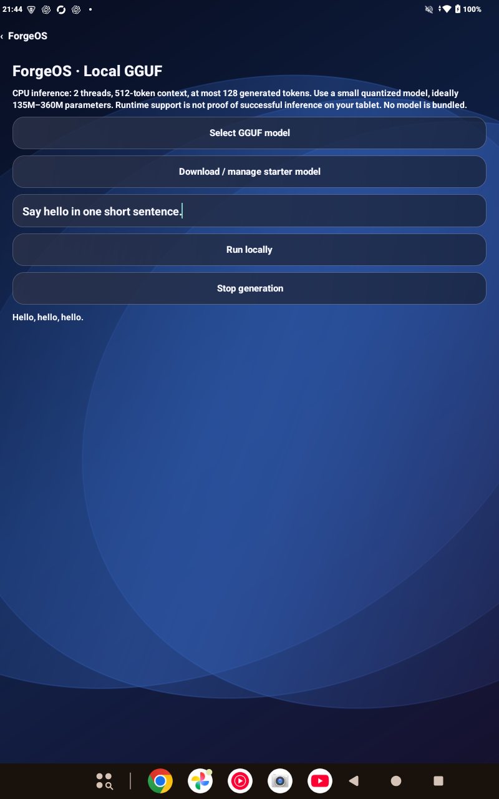
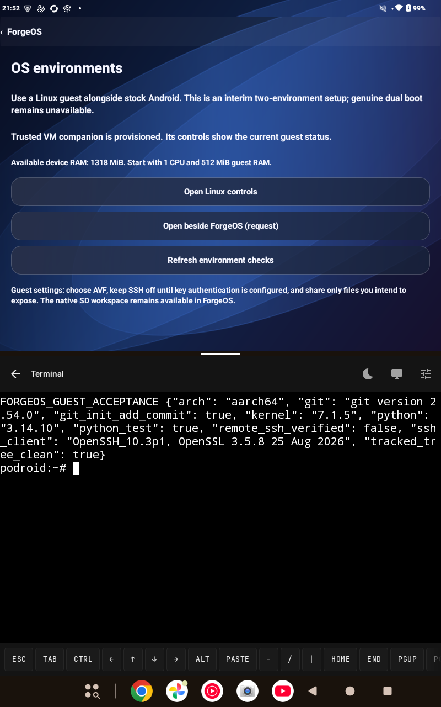

# Native 0.3 target verification

The native workstation update repairs direct SD model loading and adds trusted Linux environment controls. It runs on preserved stock Android; it is not a flashed ForgeOS operating-system image. Existing owner installation approval applies. Exact artifact identity is in [deployment.json](evidence/native-03-20261107/deployment.json).

## Actual target checks

| Feature | Result and limit |
|---|---|
| Update installation | Stable owner signer; in-place 0.3.0-review update accepted by Android. Workspace and selected SD model URI remained available. |
| SD inference | The pinned 105,454,432-byte SmolLM2-135M Q4_K_M loaded directly through its persisted document grant and generated text. The greeting fixture returned “Hello, hello, hello.” |
| Model quality | A different short greeting request generated an off-topic letter. Both outputs are retained. This is a weak small local model, not evidence of reliable coding or universal instruction following. |
| Native environment controls | Actual companion signing certificate and declared VM permissions passed. Controls opened its real app. No running-state claim is inferred from package presence. |
| Split screen | Native adjacent-launch action created visible ForgeOS and Podroid multi-window tasks; live Linux Python/Git checks passed with both panes visible. |
| Touch resize | ADB-injected touch drag changed pane bounds from 0..635 / 645..1280 to 0..447 / 457..1280. Human finger/multitouch and arbitrary floating windows remain unverified. |
| End state | Guest stopped to release RAM, AVF retained as preference, native home restored, stock HOME unchanged. |

[Inference and earlier quality failure](evidence/native-03-20261107/sd-model-inference.json), [native controls and actual window bounds](evidence/native-03-20261107/native-environment-controls.json), [final session state](evidence/native-03-20261107/physical-session-final.json), [file hashes](evidence/native-03-20261107/sha256.json).

## Storage diagnosis and safe cleanup

Android refused the initial APK update while its device storage monitor classified internal storage LOW. The reserve threshold was 3,386,086,195 bytes; the measured available space was 3,331,317,760 bytes before cleanup. The model download made for this project was retained in two independently SHA256-verified copies: the SD workspace and a laptop backup. Only its redundant internal download was removed. Free space rose to 3,436,777,472 bytes and the update succeeded. No personal Downloads, projects or unrelated app data were deleted.

This deliberate 100.6 MiB cleanup is separate from the earlier approximately 1.93 GiB unexplained DSU free-space difference, which remains unresolved. The public FAT32 workspace is not encrypted and has FAT32 file-size limits. The private adopted f2fs volume remains mounted; the Linux VM disk is still internal app data.

## Native descriptor fix and tests

A readable descriptor supplied by Android's document provider does not grant permission to reopen its path through `/proc/self/fd`. The regression opens the real pinned GGUF, removes pathname read permissions, proves reopen fails, and requires real inference through the already-open descriptor. The old loader failed that test. The fix duplicates the descriptor, wraps it in a FILE stream and calls the pinned llama.cpp stream loader. The caller retains its descriptor; the duplicated stream remains alive until the model is destroyed. No model copy or broader file permission is introduced.

The native implementation already applies a declared model chat template. A preliminary diagnosis that it omitted templating was incorrect; no unsupported prompt-format patch was made. The physical output difference is documented as model quality.

## Recovery and remaining firmware gate

For the interim environment, stop the guest in Podroid before changing its backend. One disk-lock START_FAILED error recovered after stopping and force-stopping/reopening only the companion, preserving its disk. Never disable disk locking or clear storage as a repair. Export wanted guest data before uninstalling or clearing the companion. AVF Internet is unavailable on this stock build; explicit QEMU maintenance installed the tools before returning to faster offline AVF execution. See [the full guest review](AVF_INTERIM_REVIEW.md).

No alternate Android system image was installed, booted or flashed. Exact stock recovery firmware and a tested full restoration procedure are still missing. Genuine dual boot, the SD gsid SELinux denial and the internal DSU allocation failure remain blocked/failed. Existing flashing approval does not establish a recovery path. A native app update and a Linux VM are not represented as true dual boot.

## Automated delivery

Actions review artifacts exceeded account quota. Native APK and test bundles now use bounded unpublished draft release assets with per-file hashes. Source identity, Android signing and actual tests remain separate gates. The image builder supports exact pinned draft asset ownership, run attempt, size, whole-archive digest and the actual APK checkout recorded in bounded signing evidence. A mismatched merge checkout is rejected. The legacy Actions artifact reader remains supported.

Native CI now compiles before starting its 3 GiB emulator, frees unused tools only on that isolated worker, and checks disk headroom against the emulator system image's actual userdata floor. Draft containers are prepared before heavy jobs; later uploads must match their original source and unpublished state. This avoids embedding any reusable token. Current workflow outcomes are recorded in the final verification update; earlier failed runs remain failed.

## Final native build result

[Run42337427732](https://github.com/R347H4CK3R/ForgeOS-AI/actions/runs/42337427732), source4f50024, passed all five jobs, including12 instrumented tests in83.051seconds. Lint:0errors/69warnings. All18 native bundle files and15 UI bundle files passed independent manifest checks. The actual installed base.apk hash matches the latest CI stable-signed APK exactly, so another installation/test cycle was unnecessary. Actual dark target UI and isolated light/unsupported-environment previews were visually inspected.

Early draft containers successfully received their assets after newer documentation commits moved the branch head. The isolated UI worker reported14GiB available and completed emulator boot/tests after unused-worker-tool cleanup. Current image-input pins reference the successful native run by immutable draft release/asset IDs. An actual owner-authenticated image-builder fetch passed source, ownership, archive digest, checkout evidence and extracted APK checks. The separate read-only Actions verify-apk handoff test is recorded after its run completes. These are APK/build-input results, not proof of an Android system-image boot.
