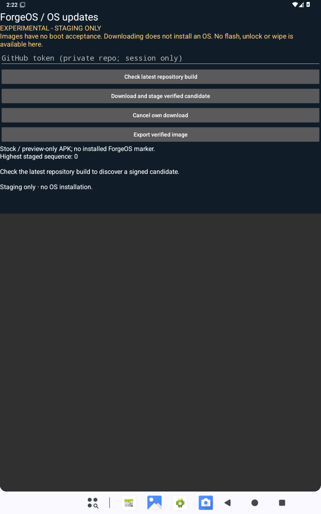

# Experimental OS image and repository update review
Date:2026-11-05 UTC. Owner UI approval is recorded. Nothing new was installed or booted on the tablet.

## Delivered build
[Integrated successful workflow42045228207](https://github.com/R347H4CK3R/ForgeOS-AI/actions/runs/42045228207), image source d3c177b5c67a19b3583fdafac0cc12067d1e37cd.
This is an actual Android15 ARM64 ext4 system filesystem adapted from a pinned vanilla TrebleDroid GSI, with the native workstation preinstalled as an ordinary app. It is not a full-source AOSP build, exact onn ROM or accepted device installation.

| Output | Artifact |
|---|---|
| Experimental system image | [13423349012](https://github.com/R347H4CK3R/ForgeOS-AI/actions/runs/42045228207/artifacts/13423349012) |
| Signed update catalog | [13423259147](https://github.com/R347H4CK3R/ForgeOS-AI/actions/runs/42045228207/artifacts/13423259147) |
| Filesystem/provenance/signing evidence | [13424462259](https://github.com/R347H4CK3R/ForgeOS-AI/actions/runs/42045228207/artifacts/13424462259) |
| Stable-signed ARM64 workstation APK | [13425455386](https://github.com/R347H4CK3R/ForgeOS-AI/actions/runs/42045228207/artifacts/13425455386) |
| Native UI and10instrumented tests | [13423447452](https://github.com/R347H4CK3R/ForgeOS-AI/actions/runs/42043033635/artifacts/13423447452) |

Image artifacts expire2026-11-12. An expired latest catalog/artifact fails closed; rebuild a verified candidate to create a newer sequence.

## Exact image identity
- Raw ext4: 2,113,343,488 bytes; SHA256 e309675589406fd9780011648ee93997446c0bfba4aa05282e76f88e7a91c04a.
- XZ: 774,758,480 bytes; SHA256 1b859a5c3f771148f7f4317a5b4845efbfb50e8ffd59bbc8264729efb1d1daa2.
- GitHub ZIP: 774,758,706 bytes; SHA256 09404d828eb9a181c62c3371bdd46b7e1c15fdf430efb81e30f6c18a9b6a86dd.
- Stable APK: 6,767,509 bytes; SHA256 75979054bae6338e5c6c6bfcec6702d080f62886d1abd041a7819498f979caf9.
- APK certificate SHA256: 4e17359b376fc57b4d39c4479c23e8c786d93b621ac33d7eaed3114287914c9a.
- Catalog version: 0.3.0-os.d3c177b5c67a.42045228207; sequence 42045228207.
The small downloaded catalog was independently verified with OpenSSL and the app's pinned public key: Verified OK. Downloaded signed APK bytes/hash match both the signing receipt and injected filesystem payload evidence. Raw/XZ agreement was verified by decompression on the isolated build worker; the775MB image was not downloaded to GamingLaptop.

## Actual validation
Native workflow42043033635 passed26unit tests and10Android15 emulator integration tests in57.837seconds, with3GB RAM and a screenshot guard against visible system error dialogs. It exercised real135M GGUF inference and model download/hash/recreation, editor/navigation, remote review, and production-key signature/tamper checks. Lint:0errors/64warnings. Actual remote1.5B integration passed on a separate GitHub worker.
OS validation42045844737 passed25/25Linux tests, including real ext4 metadata/preservation, malformed archives, actual OpenSSL signing/tampering, stable signer checks and actual Git provenance fixtures. Windows passed22with3Linux-only skips.
Integrated image build verified the exact upstream bytes, API35/security patch, actual framework multi-window resource, stable APK signer, original base preservation, payload bytes/UID/GID/mode/SELinux labels and clean read-only e2fsck. The modified image omits invalid upstream AVB footer/hash-tree/vbmeta. No trusted AVB claim is made.
Independent source review found no high-impact image/signing issue. Its provenance recommendation was implemented in353560b, extending source checks to APK workflow/scripts/attributes; it does not change this built image's payload.

## Repository update behavior
Settings / OS updates discovers the latest successful explicit ForgeOS build and verifies exact RSA3072/SHA256 metadata before trusting artifact identity or bounds. Validated unmetered Wi-Fi downloads enforce archive byte/hash limits and extracted XZ hash/size. Staging can be cancelled; verified output can be exported with the document picker. A memory-only token is needed for this private repository; no reusable token or signing private key is embedded.

The catalog and APK use separate keys. Stable app signing is not platform signing or AVB trust. Full real-image transfer in the native client and physical tablet HTTPS/session/storage behavior remain unverified. Seamless OTA apply is not implemented; there is no install/flash/unlock control.

## Hardware and installation limits
The base patch2025-03-05 is older than stock2026-04-05 and is userdebug/test-keys. Upstream lists Internet failures on some devices. This is an unsuitable production-security baseline and remains EXPERIMENTAL-DO-NOT-FLASH.
Freeform feature/config validation is not proof of target split-screen, snapping, floating controls, input, graphics, audio, power, Wi-Fi, Bluetooth or USB preservation. Exact matching OEM firmware and tested recovery are unavailable; locked AVB and rollback/VINTF/SELinux compatibility remain unresolved. Genuine dual boot is blocked; Virtual A/B is not dual boot.
The adopted SD mount was observed, but app access through its shared view remains blocked. No migration/reformat was performed. No wired-display capability is claimed.

## Recovery and proposed procedure
There is no safe executable firmware installation procedure yet. Preserve stock Android, user data and adopted encryption keys.
Before proposing any boot/flash: obtain and authenticate exact100135925/t402aa/TTA.31 stock recovery firmware; prove restore and rollback; verify partition/snapshot state, signer/AVB trust and vendor compatibility; back up and restore-test user files; then present exact candidate hashes and a device-specific recovery/install sequence for separate owner authorization.
An APK-only test is a separate reversible step: verify signer/package compatibility first, preserve original home and old apps, use a new workspace and grant only its document URI. Never uninstall an existing package or erase data to bypass a signing mismatch.
See [recovery gates](recovery-and-installation-gates.md), [verification matrix](verification-matrix.md), [hardware/OTA audit](os-phase-audit.md) and [UI review](UI_REVIEW.md).
