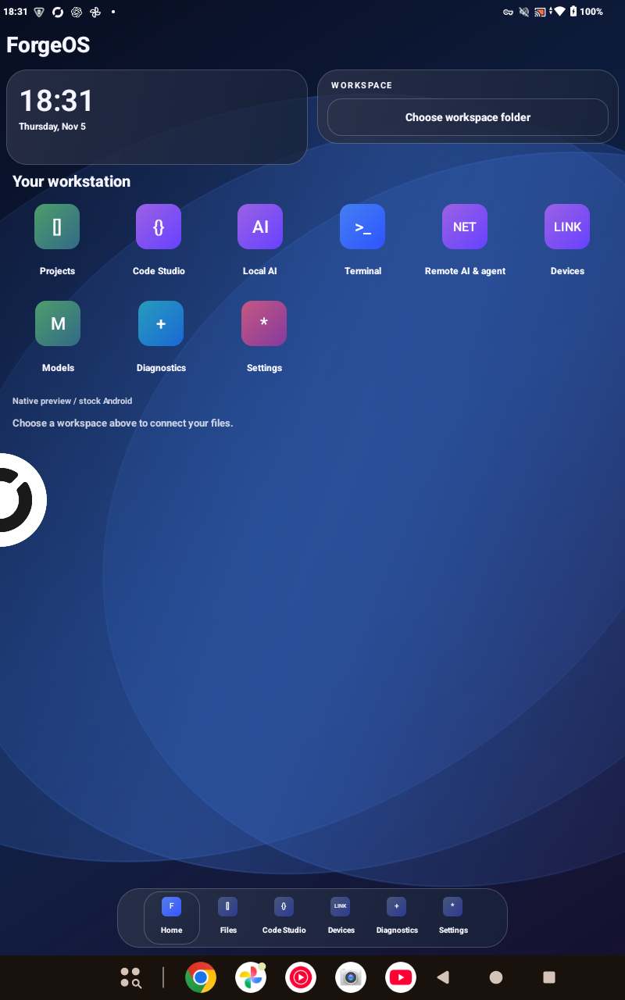
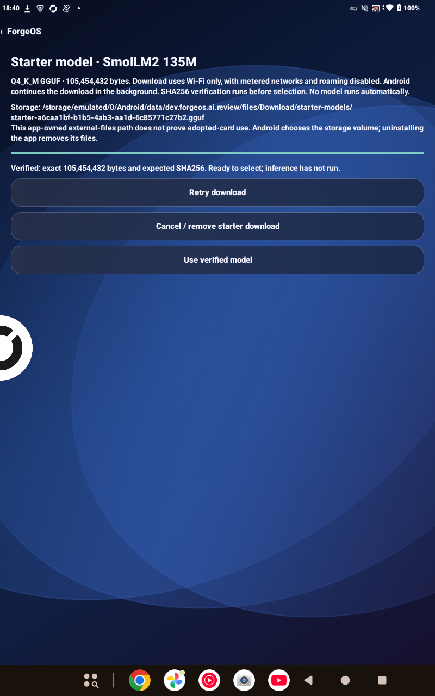
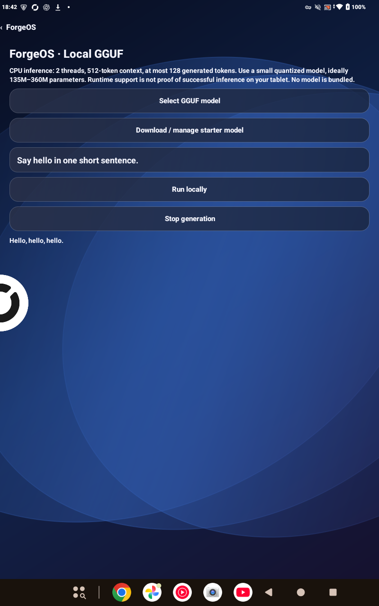
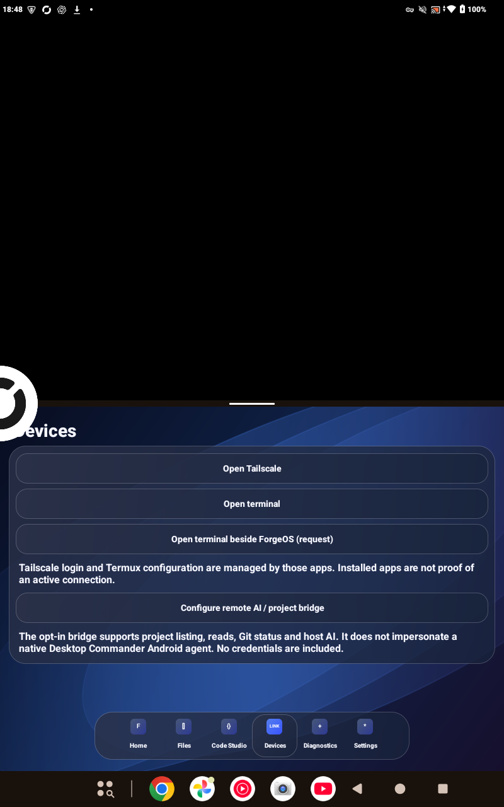
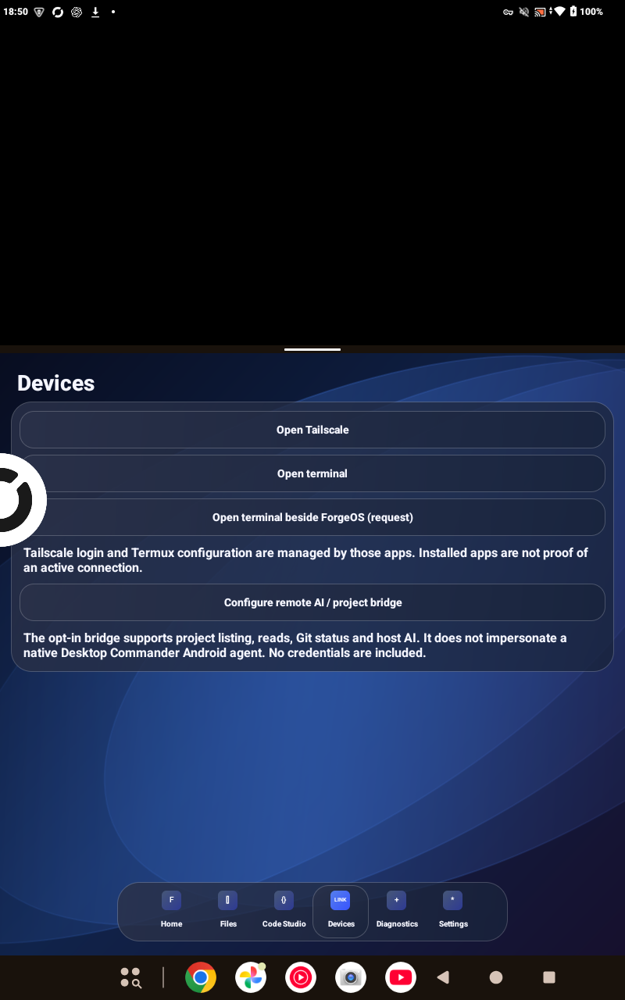

# Physical USB review: onn. 100135925

Observed 2026-11-06 UTC on stock Android 15/TTA.31. This is a native workstation test, not acceptance of the Android16 OS candidate. The approved Strata-style interface is implemented in native Android views.

## Results actually observed

| Check | Result and limit |
|---|---|
| USB ADB | Verified exact target over USB, in addition to wireless ADB. Normal screen unlock verified before tests. |
| Native UI | Dashboard renders on the actual 800x1280 portrait display. Stock HOME remains com.android.launcher3. |
| Starter download | Actual tablet DownloadManager transfer completed: 105,454,432 bytes. UI verification and independent ADB SHA256 both match 2e8040ceae7815abe0dcb3540b9995eaa1fa0d2ca9e797d0a635ae4433c68c2d. |
| Model handoff | Use verified model successfully selected the downloaded GGUF in LocalActivity. No picker or file-URI exception observed. |
| ARM64 local inference | Actual SmolLM2-135M-Instruct Q4_K_M answered `Say hello in one short sentence.` with `Hello, hello, hello.` This verifies one generation, not useful coding quality or long conversations. |
| Resource use | Runtime bounded to 2 CPU threads / 512-token context / 128 output tokens. A separate observation after completion measured 77,408 KiB PSS / 138,797 KiB RSS / 9,214 KiB swap PSS. This is NOT peak inference memory or a throughput benchmark. |
| Split-screen request | ForgeOS Devices > Open terminal beside ForgeOS placed both apps in native MULTI-WINDOW tasks: Termux [0,0][800,635], ForgeOS [0,645][800,1280]. |
| Divider resize | ADB-injected drag of the visible native divider changed bounds to Termux [0,0][800,442], ForgeOS [0,452][800,1280]. ForgeOS resized and rendered. This is not physical finger acceptance. |
| Second app rendering | Termux pane remained black in captured output despite a live bash process. Initial IME-visible captures were entirely black; after Back hid IME, ForgeOS rendered in its lower pane. A later stock Settings capture also had a blank detail pane. Root cause is unresolved; this is not proof of a ForgeOS drawing defect or proof of two usable visible apps. |
| Terminal tools | Existing Termux 0.118.0 opens; bash process exists. Injected read-only version probe produced no observable text. Python/Git/SSH execution and ForgeOS command callback remain unverified. |
| Bootloader transport | Initially blocked by Windows Code28 / missing driver. Resolved using the exact-ID-matching, Microsoft-signed MediaTek package described below. Fastboot now enumerates the unique tablet and read-only queries succeed. |
| Unlock state | Physical bootloader reports unlocked:no, secure:yes, current-slot:b, is-userspace:no. flashing get_unlock_ability reports unlock_ability=0. This is the current OEM unlock policy state, not proof that unlocking can never be enabled. No unlock command was sent. |
| Stock return | fastboot reboot succeeded. ADB later verified sys.boot_completed=1, original TTA.31 fingerprint, locked=1, AVBgreen, same slot_b, stock Home and stay-awake=0. Initial 27-second completion check was too early; a later observation passed. This verifies normal bootloader-to-stock return, not restoration after a failed flash. |

The downloaded starter model is under primary shared internal app storage, not proven to reside on the adopted card. The app code/private data remain installed on the adopted volume. Workspace SAF selection and separate-OS access to the encrypted card remain unverified.

## Actual screenshots

Screenshots include an existing remote-control overlay at the left edge. It is not a ForgeOS control. Screenshot hashes are recorded in evidence/physical-usb-20261106/screenshots.json. No user document contents, private backup inventory, credentials or private keys are included.

## Test harness limitation

ModelManager updates every 750ms. Stock uiautomator could not reach idle and left an old XML dump in place. We rejected the stale screen and used fresh screenshots for download/handoff taps. This was not treated as navigation failure. Two Windows scripting issues (native argument quoting and console Unicode encoding) were diagnosed separately; neither is an Android product failure.

## Firmware and recovery boundary

No unlock, wipe, flash, relock, slot switch, DSU installation or candidate boot command was sent. The temporary USB stay-awake setting was restored from2 to its original0 before the bootloader reboot. The first probe could only enumerate USB. After the trusted driver correction, the second probe queried read-only metadata and unlock ability, then rebooted stock. Neither snapshot-update-status nor max-fetch-size is supported: output contains FAILED/GetVar Variable Not found despite fastboot returning process code0. No snapshot merge-state or partition-fetch capability is inferred.

Already-granted unlock/flash/conditional-wipe approval remains in effect. The driver blocker is resolved. Actual modification remains blocked by current unlock_ability=0, unauthenticated exact TTA.31 recovery firmware/tested restoration, and DSU internal-space constraints. Do not install an unsigned/custom driver or change Windows test-signing/Secure Boot just to bypass this check. Preserve stock; Virtual A/B slots are not a dual-boot scheme. See SECOND_SYSTEM_REVIEW.md and AUTHORIZATION.md.

## Signed Windows driver correction

The initial Code28 failure was diagnosed using the present device hardware IDs and pnputil driver matching. No driver was installed by name alone.

- Microsoft Update Catalog exact hardware-ID search: https://www.catalog.update.microsoft.com/Search.aspx?q=USB%5CVID_0E8D%26PID_201C
- Catalog update ID: c3b902b5-6a21-48fd-bae7-f1408c1b2120. The catalog labels it Android ADB Interface; the physical USB protocol and actual fastboot exchange, rather than that display name, establish this bootloader transport.
- Download: https://catalog.s.download.windowsupdate.com/d/msdownload/update/driver/drvs/2016/10/20931647_c83f434a6c4ffff12b48edefe161d6085bb63bcd.cab
- CAB 8,580,899 bytes; SHA25618bc9abdb548f491069e3de005122d4e9645167e05b3bfde62b97b5b1f1f04ce.
- Unmodified android_winusb.inf NTamd64 section matches USB\VID_0E8D&PID_201C and uses Windows WinUSB.sys. DriverVer08/28/2016,11.0.0000.00000.
- Get-AuthenticodeSignature on android_winusb.cat: Valid / Signature verified; signer Microsoft Windows Hardware Compatibility Publisher. pnputil performed package integrity checks and added/installed it successfully as oem9.inf on the matching device.
- No reboot of Windows, UAC dialog, custom INF, signing-enforcement change, Secure Boot change or game setting change was required. The CAB/driver binaries are kept on the owner's laptop, not committed to this repository.

## Actual bootloader identity

product:t402v; version-bootloader:t402v-c492161-20250419153113-20260411163423. Android still reports ro.product.board=t402aa and ro.boot.hardware=mt8786. These are different observed identifiers for the same USB-serial-matched physical tablet. Do not choose firmware for a similar model from either string alone.

Bootloader partition-size values are hexadecimal: boot_b0x2000000 (32MiB), init_boot_b0x800000 (8MiB), vendor_boot_b0x4000000 (64MiB), super0x194000000 (6,777,995,264bytes). These are metadata, not partition backups. Full read-only query output and independently checked stock-return properties are saved alongside the screenshot manifest.
