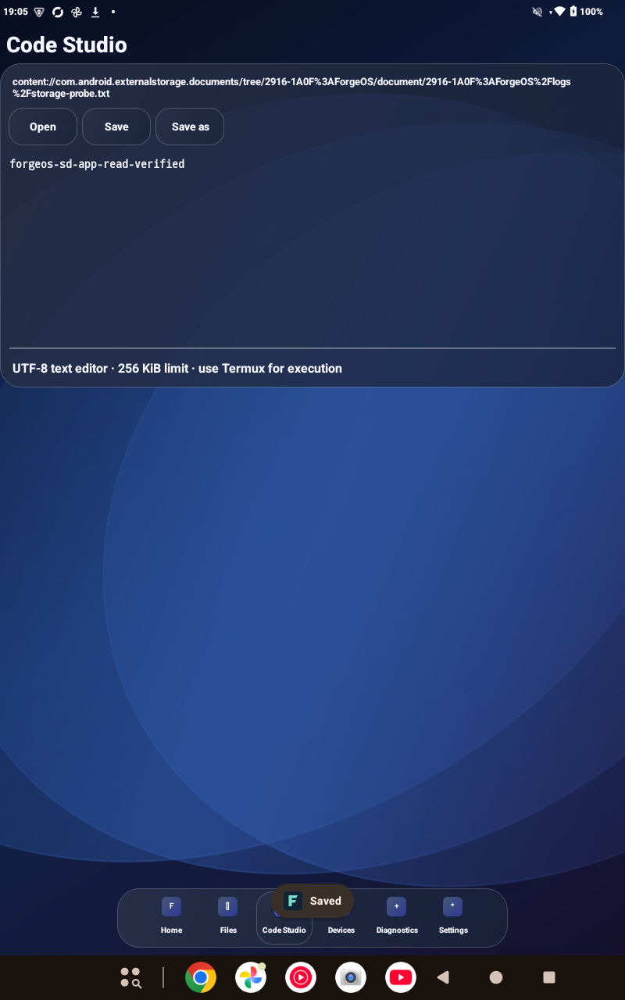
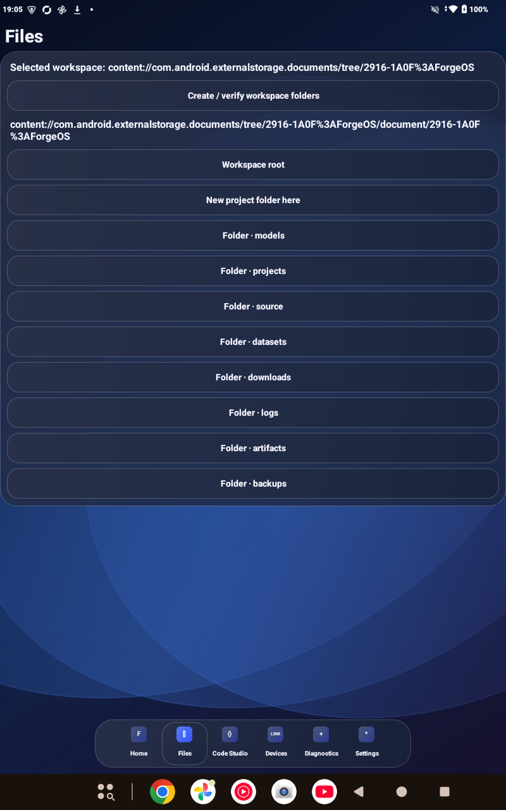

# Actual SD workspace app verification

The existing native review APK on stock Android was granted persistent read/write access through Android's normal folder picker to:

content://com.android.externalstorage.documents/tree/2916-1A0F%3AForgeOS

The app's Create / verify workspace folders action completed. Models, projects, source, datasets, downloads, logs, artifacts and backups were all listed through the app's document provider. A controlled logs/storage-probe.txt file was seeded with forgeos-sd-app-read. Code Studio loaded the exact text, appended -verified, and saved after the replacement confirmation. A separate ADB read matched forgeos-sd-app-read-verified exactly.

The app was force-stopped and relaunched; its Files screen retained the workspace and listed all eight directories. This proves persistence across process restart, not yet across a full tablet reboot. The first automation paused on the capitalized SAVE confirmation; after inspecting the actual dialog, the pending save was confirmed and the remaining checks completed. That automation mismatch is not counted as an application failure.

This is the portable FAT32 part of the card; it is not encrypted adoptable storage. The separate private f2fs partition remains mounted. Model placement, inference from the SD path, arbitrary build execution, broader file operations and full peripheral testing are not established by this test.

[Machine-readable result](evidence/small-userdata-20261107/sd-app-access.json) and [evidence SHA256 manifest](evidence/small-userdata-20261107/sha256.json).

The app remains a native workstation preview on stock Android. Genuine second-system boot is separately blocked; see [the latest failed trial and cleanup limits](DSU_SMALL_USERDATA_REVIEW.md).
