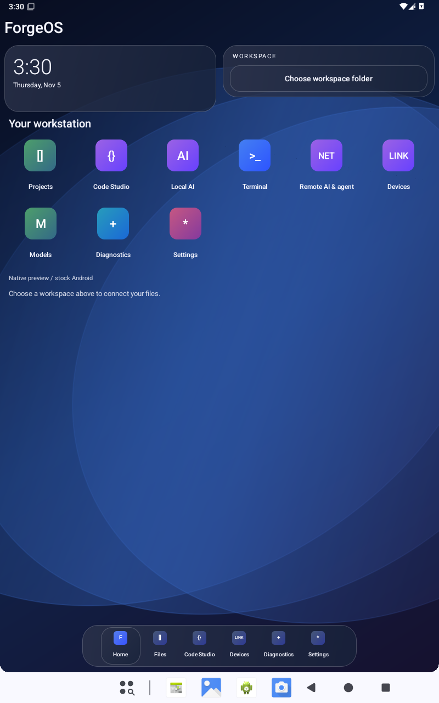
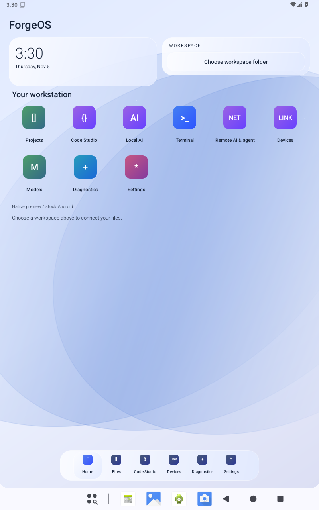
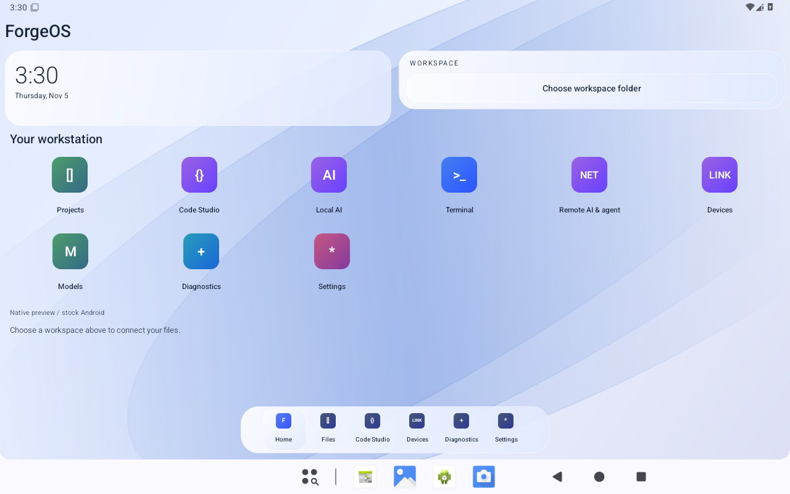
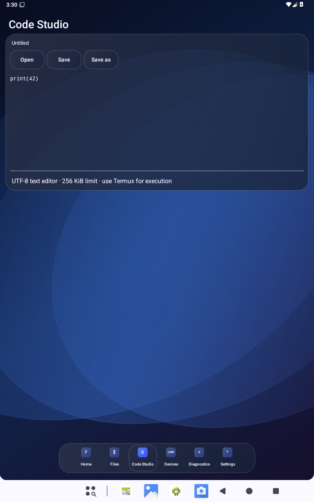
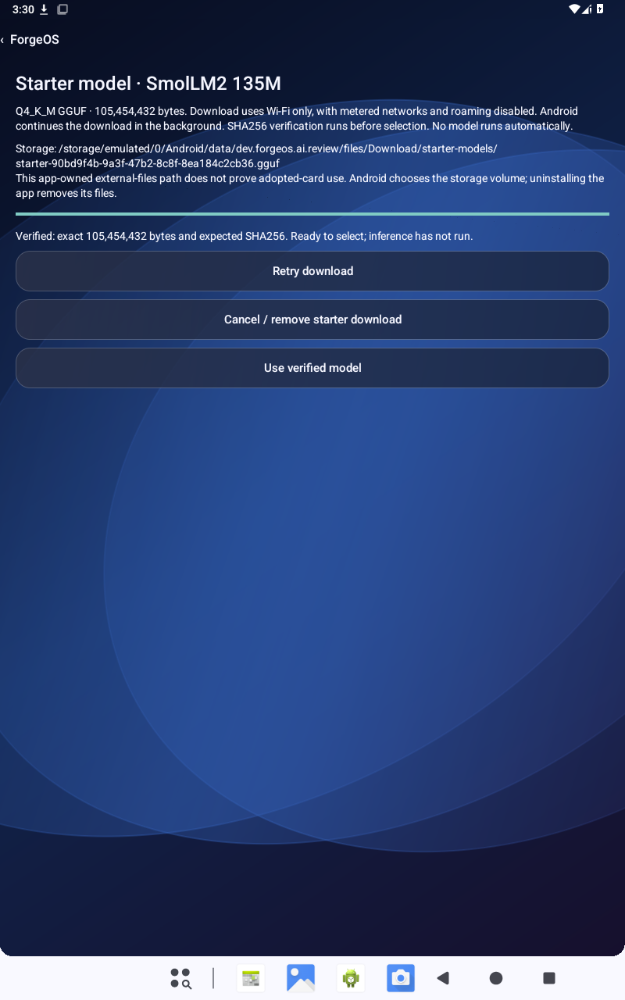
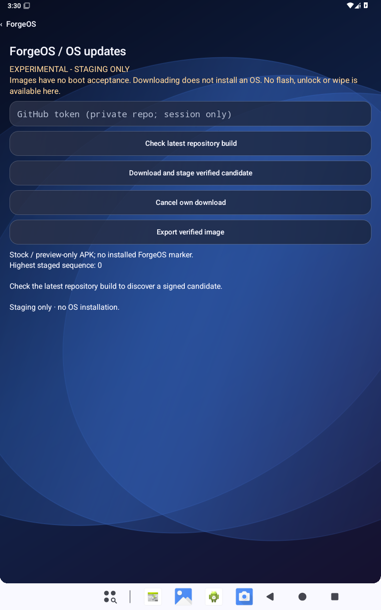

# ForgeOS Strata-style native interface
The owner requested Strata iOS styling. This adapts its iOS Home Screen mode for the ForgeOS workstation; it does not add an iOS runtime or claim the console/Big Picture modes.
Reference inspected: huzaifahshahid71-ops/Strata commit9b9c86324395e484c4078e1d2883cc49b4a17dad, LiveBoardHomeScreen.swift. Native Android layout and drawables are original; no branded artwork or Swift implementation is bundled.

## Implemented
- Static blue/violet ribbon wallpaper and translucent rounded surfaces.
- Responsive workstation icon grid with real Projects, editor, local AI, terminal, remote agent, Devices, Models, Diagnostics and Settings actions.
- Real local clock/date widget and workspace folder picker.
- Floating navigation dock with selected destination, touch targets and scrolling on narrow windows.
- Shared light/dark styling for local AI, remote AI, terminal, model management and signed OS staging.
- Tool back navigation preserves the launcher Activity and editor state.

## Efficiency
No bitmap wallpaper, runtime blur, continuous animation or extra dependency. Android Canvas draws static gradients and three ribbon shapes. TextClock follows Android's lifecycle and minute updates. Model/runtime limits and permission/approval boundaries are unchanged.

## Verification
[Native workflow42054065879](https://github.com/R347H4CK3R/ForgeOS-AI/actions/runs/42054065879) passed all jobs on source10e2d267242d0407c3e88fa378d122817f034e7a.
- Android unit tests:26 passed,0 failed.
- Android15 emulator:10 passed in72.067seconds, including theme consistency for the suffixed review package, real135M inference/download, editor recreation, navigation and signed-catalog tamper checks.
- Lint:0 errors /65 warnings; ARM64 APK verification and separate remote1.5B integration passed.
- Debug APK:6,756,328 bytes; SHA256 cdd961dc7e079ac358255b627bbac4adf05a5ecec959659a73b7162a6f74b940.
- Independent review confirmed API guards, named font constants and shared-theme preference lookup. The final actual screenshots were additionally inspected.

## Actual emulator previews

No visible system error dialog, obscured screen or clipped primary control was accepted. These are actual emulator captures, not generated mockups. They do not establish physical tablet acceptance.
The image pipeline pins this exact successful APK in commit df21a82; integrated workflow42056016871 passed. Current image artifact13430415448 and stable APK artifact13428468535 are recorded with exact hashes in [OS_REVIEW.md](OS_REVIEW.md).
Physical tablet UI/peripheral/window acceptance and firmware recovery gates remain separate. No new APK or OS is installed.
