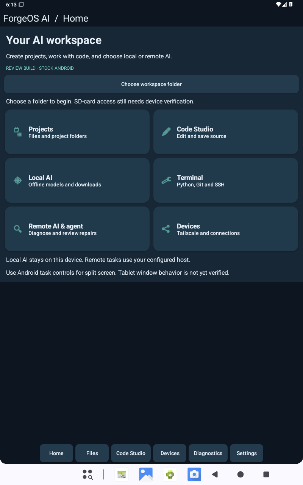
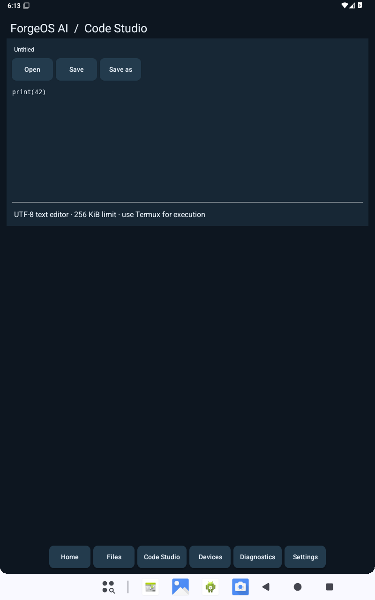
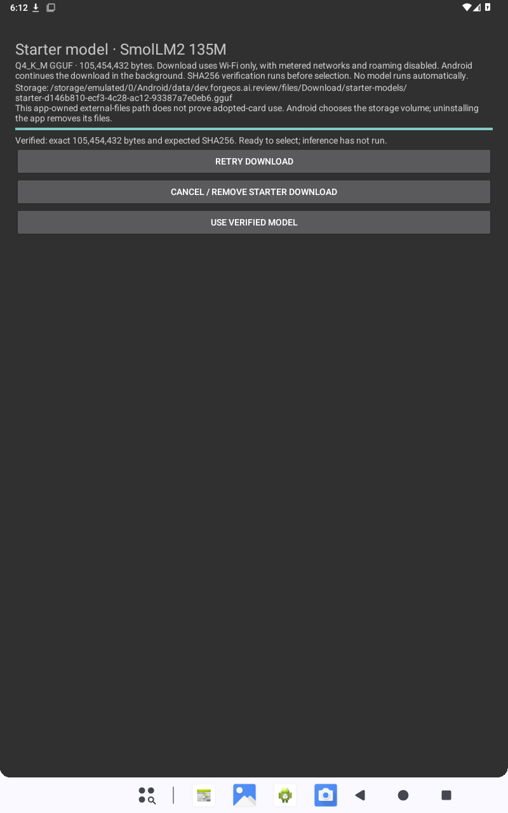
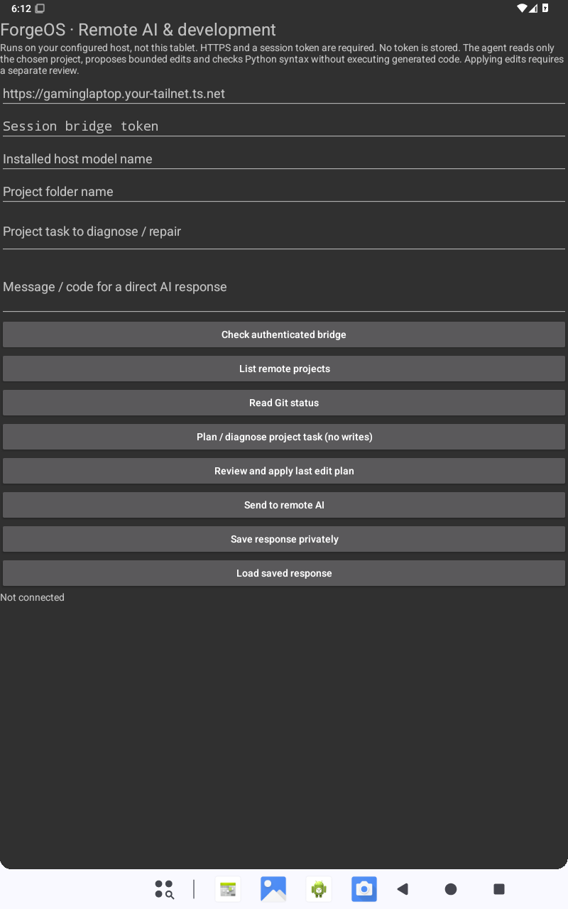
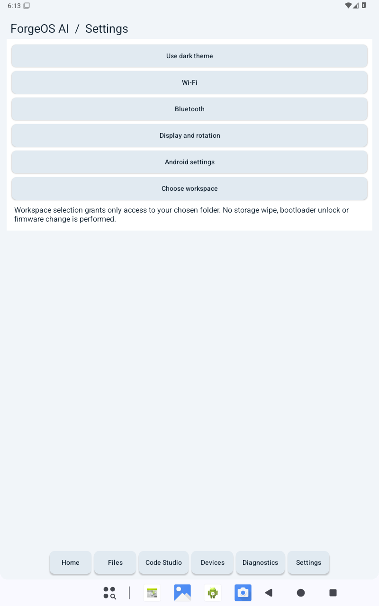
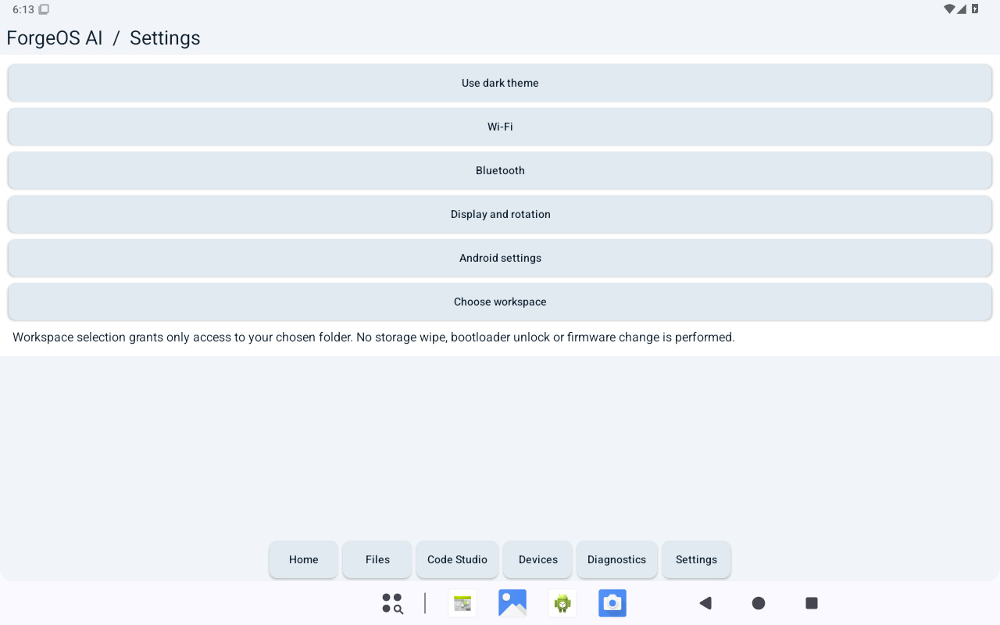

# ForgeOS AI: native workstation review
**Review build on stock Android. The custom OS image and genuine dual boot are not ready.**
No new APK or image has been installed on the target tablet.

## Source and artifacts
- Candidate: [cf01a34](https://github.com/R347H4CK3R/ForgeOS-AI/commit/cf01a34edddb5466643e09229f33554f7662e8d4).
- [Successful workflow 41978243888](https://github.com/R347H4CK3R/ForgeOS-AI/actions/runs/41978243888).
- [ARM64 APK and reports](https://github.com/R347H4CK3R/ForgeOS-AI/actions/runs/41978243888/artifacts/13392956874).
- [UI screenshots and instrumented results](https://github.com/R347H4CK3R/ForgeOS-AI/actions/runs/41978243888/artifacts/13392987066).
- [Actual remote-model evidence](https://github.com/R347H4CK3R/ForgeOS-AI/actions/runs/41978243888/artifacts/13392084233).
APK: 6,722,453 bytes, package dev.forgeos.ai.review, label ForgeOS AI Review.
SHA256: `c6ac7a200f9fc45f2f18d5e141c01b71345026a4588d6130909db015e5b36dea`.
Download was independently rehashed; CI APK signature verification passed. Native library is ARM64.
This is a debug-signed review artifact. A stable private release-signing setup is still needed for production updates; different CI debug keys can prevent in-place updates. Do not uninstall existing apps to work around signature mismatches.

## Actual UI
Captured from the running Android 15 emulator at 800x1280, not design mockups.

Portrait, landscape, editor, downloader and remote screens were visually inspected. Capture timing and light-theme system-bar background issues were corrected before this review.

## Feature checklist
| Area | Implemented and tested scope | Remaining acceptance |
|---|---|---|
| Home/UI | Native HOME dashboard, launcher dock, light/dark launcher themes and rotation | Target touch/keyboard/mouse behavior |
| Workspace/editor | SAF browsing, project folders, eight workspace directories, bounded UTF-8 open/save/save-as, draft recreation and race guards | Actual adopted-card access; broader file operations |
| Local AI | Pinned llama.cpp JNI, 135M GGUF generation, cancellation and RAM/model guards | Tablet speed, thermals, RAM and output quality |
| Models | Real Wi-Fi-only download, byte progress, cancellation/retry, exact SHA256 and recreation | Target download-to-inference handoff; SD placement |
| Remote AI/agent | HTTPS session client, bounded reads/proposals, Python syntax diagnosis, hash-bound edit approval, backups and rollback | Tablet HTTPS session and complex-project reliability |
| Terminal/tools | Supported Termux RUN_COMMAND, exact command confirmation, private result receiver | Termux permissions/configuration and actual tablet Python/Git/SSH |
| Windows | Resizable activities and adjacent launch requests; experimental AOSP framework integration | Target split/freeform/snapping/window controls |

## Test results
- Android unit tests: **8 passed, 0 failed**.
- Native emulator integration: **8 passed in 37.863 seconds**. Includes real GGUF generation, cancellation, native navigation/editor recreation, slow-open/save regression, remote review UI, and actual model download/hash/recreation.
- Windows bridge: **29 discovered, 28 passed, 1 live-model skip**. Includes Windows junction and alias regressions.
- Linux bridge in this workflow: **29 discovered, 27 passed, 2 expected skips** (Windows junction and opt-in live model).
- Separate actual remote-model test: **passed in 33.181 seconds**, using pinned qwen2.5-coder:1.5b. It read main.py, proposed print(1) -> print(2), proved no write before approval, then verified approved contents.
- Lint: **0 errors, 62 warnings**. Warnings are not claimed resolved.
- Independent final source review found no important correctness/security blockers in the tool-schema, loop guard and window-controller fixes.
[Native test output](evidence/native-ui-cf01a34.txt), [local generation](evidence/local-inference-cf01a34.txt), [synthetic remote evidence](evidence/live-agent-cf01a34.json).

## Efficiency and limits
APK is about 54% smaller than the earlier 14,508,156-byte build. Native UI has no WebView runtime. CPU inference uses two threads, 512-token context, 128 output tokens, a 550 MiB model-file cap, a 600M parameter cap and at least 850 MiB available-RAM requirement. Models are released after each response. The 135M starter demonstrates inference execution, not strong coding competence.
The accepted remote 1.5B model runs on the configured host, not locally on this tablet. The 0.5B model proved unreliable during repeat testing. A successful one-line edit is not proof of general autonomous repair.
The bridge exposes no arbitrary shell or generated-program execution. Python diagnosis parses syntax; it does not execute project tests. Conflicts are detected optimistically, not by a cross-process atomic transaction.
Termux results currently share one last-result slot; overlapping commands and truncated output need further usability work.
No heavy compilation, WSL startup or continuously running model was started on GamingLaptop.

## Hardware and firmware risks
The adopted card is mounted, but its emulated shared view is unmounted and primary shared storage remains internal. App access is not established. No migration or reformat was performed.
Physical multi-window behavior, Bluetooth/USB peripherals, audio, rotation/input and HDMI remain unaccepted. Wi-Fi and a tablet-to-laptop Tailscale ping were verified, not a complete app HTTPS session.
Exact authenticated stock recovery firmware, tested restoration and an adequate AOSP build worker have not been established. There is no verified system image or safe executable firmware installation procedure. Unlocking may wipe userdata and jeopardize adopted-storage encryption keys. Virtual A/B is not genuine dual boot.
See [hardware audit](hardware-audit.md), [verification matrix](verification-matrix.md), [recovery gates](recovery-and-installation-gates.md) and [deliverables](deliverables.md).

## Proposed installation and rollback
After explicit UI/test approval, the next stage is **APK-only target testing**:
1. Verify the exact APK SHA256/signature and recheck tablet identity, available space and existing packages.
2. Install only the separate dev.forgeos.ai.review package. Preserve dev.forgeos.ai, stock firmware, existing data and the original home.
3. Launch without changing the default home. Use a new test workspace folder; verify storage permissions before opening existing projects.
4. Verify local model management/inference, Termux tools, HTTPS host connectivity and native task behavior. Physical peripherals are tested only when connected.
5. Stop on errors and collect diagnostics. No broad storage permission, firmware change or destructive command is used as a workaround.

App rollback: return to the original launcher through Android Home settings. Uninstalling only the review package removes its private histories and downloaded models; it is not firmware recovery. Shared workspace files are separate.
No OS image boot, unlock, wipe, partition change, SD format/migration or flash is proposed. Each requires a device-specific recovery plan and separate explicit authorization.
